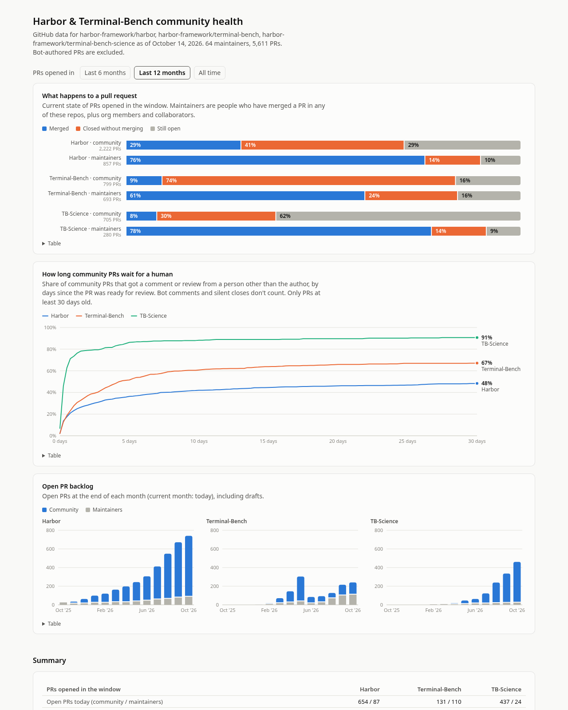

# Harbor & Terminal-Bench community health

https://not-stbenjam.github.io/harbor-community-health/

Charts for PR flow, review times, contributors, task PRs and task proposals
across [harbor](https://github.com/harbor-framework/harbor),
[terminal-bench](https://github.com/harbor-framework/terminal-bench) and
[terminal-bench-science](https://github.com/harbor-framework/terminal-bench-science).



## Running locally

```sh
python3 fetch.py      # GitHub -> data/*.json, via `gh api graphql` (~15 min)
python3 build.py      # data/*.json -> site/index.html
xdg-open site/index.html
```

`site/index.html` is self-contained. Repos, extra maintainers and bot accounts
are listed in `config.py`. The Publish workflow refetches and redeploys daily.

## Definitions

- **Maintainers**: anyone who has merged a PR in any configured repo, plus
  authors whose association is OWNER, MEMBER or COLLABORATOR. Everyone else is
  community.
- **Human reply**: a comment or review from a human other than the PR author.
  Bot comments and silent closes or merges don't count.
- **Review**: a submitted GitHub review (approve, request changes or comment).
- Clocks start when a PR is marked ready for review, or at creation if it was
  never a draft.
